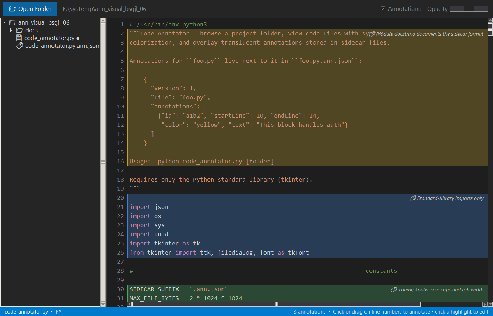

# Code Annotator

A small desktop tool for browsing a project folder and viewing code files with
syntax colorization, with **annotations overlaid transparently** on top of the
source. Annotations live in a **parallel tree** that mirrors the source
layout, so they never touch the source files themselves.



## Requirements

- Python 3.4+ (only the standard library is used — tkinter ships with the
  official Windows installer). No pip installs needed.

## Run

```sh
python code_annotator.py            # then click "Open Folder"
python code_annotator.py C:\path\to\project   # open a folder directly
python code_annotator.py C:\path\to\project -a D:\notes\project-anns
```

`-a/--annotations ANN_ROOT` sets the root of the annotation tree. When
omitted, it defaults to `.annotations/` under the **git repository root**
containing the opened folder — so opening any subfolder of a repo still finds
the same annotations — or under the opened folder itself when it isn't inside
a git repo. The active annotation root is shown in the toolbar.

## Using it

- **Browse** — the left pane shows the project tree (lazily loaded;
  `node_modules`, `.git`, build output, etc. are skipped). Files that have
  annotations show a `●` badge.
- **View** — select a code file to render it with syntax colorization
  (Python, JS/TS, C/C++, C#, Java, Go, Rust, SQL, shell/PowerShell, HTML/XML,
  CSS, JSON, and more).
- **Navigate** — `Ctrl+F` finds text (`F3`/`Shift+F3` or `Enter`/`Shift+Enter`
  cycle matches, all matches highlighted), `Ctrl+G` jumps to a line,
  `Alt+Down`/`Alt+Up` jump to the next/previous annotation (wrapping around),
  arrows/PageUp/PageDown/Home/End scroll, and `Ctrl+wheel` (or
  `Ctrl+=`/`Ctrl+-`, `Ctrl+0` to reset) zooms the code. `Esc` dismisses.
- **Copy** — click a line in the code view to select it (drag or Shift+click
  for a range), then `Ctrl+C` copies the selected lines.
- **Edit source** — *✎ Edit* in the toolbar swaps in a real editor over the
  same file, with syntax colors and full undo/redo (`Ctrl+Z` undo, `Ctrl+Y` or
  `Ctrl+Shift+Z` redo). `Ctrl+S` (or the *Save* button) writes the file;
  *✓ Done* returns to the annotate view, prompting if there are unsaved
  changes. Annotation highlights ride along with the text while you edit, and
  their saved line positions are updated on save. Editing requires the file
  to be valid UTF-8; its newline style is preserved.
- **Annotate** — click or drag on the **line numbers** to pick a line range,
  then write a note and choose a highlight color. The annotation appears as a
  translucent color band over those lines with the note text floating at the
  right edge, word-wrapped (line breaks preserved) to stay clear of the code;
  notes re-wrap when the window is resized or scrolled horizontally.
- **Edit** — click an existing highlight band (or its note) to edit or delete
  it.
- **Insert as comment** — in the edit dialog, *Insert into code as comment…*
  places the note as comment lines in the file's own comment syntax, indented
  to match. Click a line number (or a code line) to place it, or press
  `Enter` for the default spot just above the annotated region; `Esc`
  cancels. The comment is inserted **in the editor as a pending edit** —
  `Ctrl+Z`/`Ctrl+Y` undo and redo it like any other edit, and nothing touches
  the file until you save (`Ctrl+S`). Annotation positions follow the
  inserted lines automatically when you save.
- **Overlay controls** — the toolbar has an *Annotations* show/hide toggle and
  an *Opacity* slider that adjusts how strongly the overlay blends over the
  code.

## Annotation storage

Annotations mirror the source layout under the annotation root. For a repo at
`C:\proj` with source file `C:\proj\src\util\foo.py`, the annotations live in:

```
C:\proj\.annotations\src\util\foo.py.ann.json
```

Each annotation file is plain JSON:

```json
{
  "version": 1,
  "file": "src/util/foo.py",
  "annotations": [
    {
      "id": "a1b2c3d4",
      "startLine": 10,
      "endLine": 14,
      "color": "yellow",
      "text": "This block handles auth"
    }
  ]
}
```

- `file` is the source path relative to the base (git repo root or opened
  folder), with forward slashes.
- `startLine`/`endLine` are 1-based and inclusive.
- `color` is one of `yellow`, `green`, `blue`, `pink`, `purple`, `orange`.
- Files and mirrored directories are created on first save; when the last
  annotation on a file is removed, its file is deleted and empty directories
  are pruned.
- The annotation tree is hidden in the app's file browser; annotated files
  show a `●` badge instead.

The format is plain JSON so the annotation tree diffs cleanly in version
control and can be generated by other tools.

## Annotating with an LLM

`.claude/skills/annotate-codebase/SKILL.md` is a skill file that teaches an
LLM (e.g. Claude Code) the storage layout, JSON schema, color convention, and
line-numbering rules — ask it to "annotate this codebase" and view the result
in the app.
